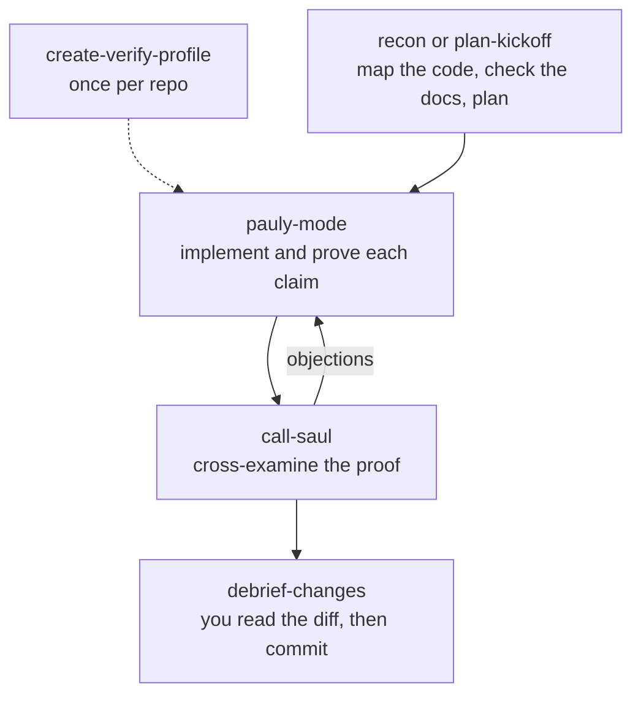

# paulystack

**Stop outsourcing your understanding.**

<p align="center">
  
</p>

paulystack is a Claude Code plugin with 11 skills. They make the agent research before it acts, plan before it writes code, and prove a change works before it says "done". You still read the diff, make the decisions, and run `git commit` yourself.

What it adds over plain Claude Code:

- Every claim the agent makes about a change gets a command, that command's captured output, and a step verdict: `seen`, `inferred`, `not checked`, or `failed`. Output that doesn't show the claim is never marked `seen`.
- Before the final verdict, a reviewer with a fresh context cross-examines the proof and returns only the objections that leave reasonable doubt.
- The proof is saved as a report on your machine, so you can reread what ran and what it printed.
- A per-repo verify profile tells the agent how to run, test, and check the repo on each stage, so it doesn't guess.

## Install

You need Claude Code and `git`. The bundled MCP servers need `npx`, and `pr-recon` needs `gh` signed in.

This repo is a plugin marketplace that holds one plugin, so both are named `paulystack`.

1. Add the marketplace:

   ```bash
   claude plugin marketplace add SupaxInc/paulystack
   ```

2. Install the plugin:

   ```bash
   claude plugin install paulystack@paulystack
   ```

   You should see `✔ Successfully installed plugin: paulystack@paulystack (scope: user)`.

3. Start a new session, or run `/reload-plugins` in an open one. `claude plugin details paulystack` should list `Skills (11)`.

The skill descriptions add about 1.8k tokens to every session. A skill's full instructions load only when it runs.

To pick up a new release, run `claude plugin marketplace update paulystack`, then `claude plugin update paulystack@paulystack`.

## Try it without setup

These skills need no verify profile. Run them in any repo:

- With uncommitted changes, type `/paulystack:debrief-changes` or ask "debrief my changes". You get the diff explained and grouped by concept. A complex diff also gets an HTML page that traces a request through the code.
- `/paulystack:recon how do we handle refresh tokens` maps the relevant code, checks current docs for the versions you pin, and returns an analysis. It writes no plan and no code.
- `/paulystack:pr-recon 482` reviews pull request #482. Run it from a worktree checked out at the PR's head: it never fetches or checks out, and if HEAD doesn't match the PR it prints the commands for you to run. It opens with a merge verdict and, when it found a ticket or RFC, the requirements met or missed. Then come the findings, each with a draft comment. It never posts to GitHub.

## Prove a change

In a repo you want to work on:

1. Create the verify profile once:

   ```
   /paulystack:create-verify-profile
   ```

   It reads how the repo runs, is tested, and is deployed, and asks once for what no file shows, such as staging URLs or which staging actions are safe. Then it tries each stage once: it launches the app locally, and runs one read-only deploy query and one read-only observability query per remote stage. It asks before a launch that writes outside the repo, and shows the draft for your OK before saving it.

2. Turn on pauly-mode with a task:

   ```
   /paulystack:pauly-mode the export button returns a 500 when the list is empty
   ```

   pauly-mode makes the change, then proves it. You should see:

   - a status line like `pauly-mode on · <repo> · profile: fresh · …`
   - `Playbook: bug, because …` and `Stage: local, because …`, which you can correct
   - one proof block per "Done means" criterion: the criterion with its step verdict, the exact command, and 1 to 3 lines from its log
   - `Not checked`, `Your checks` (what only you can confirm), the cross-exam result, and the overall verdict: `proven`, `partly proven`, or `not proven`
   - a `Verification files` block with the paths to the report, the cross-exam, and the logs

   pauly-mode stays on for the session. `/paulystack:pauly-mode off` turns it off.

## What it touches

- The skills never commit or push. In your repo they write only the change you asked for, or a doc or skill you approved. Reports and pages go under your home directory unless you give a path.
- Prod is read-only. On staging, pauly-mode writes only through the profile's safe test actions, each with its cleanup, and only after you OK it that turn.
- pauly-mode uses only MCP tools that read, never raw SQL or code runners, and `gh api` only as a GET.
- It never reads `.env` files other than `*.example`, and reports hold no secret values.
- `pr-recon` never posts, approves, comments, fetches, or changes the checkout.

## How it works



1. **Once per repo**, `create-verify-profile` saves `~/.claude/verify-profiles/<repo>/profile.md`.
2. **Before a change**, `recon` maps the code and returns an analysis. `/paulystack:plan-kickoff` runs the same research in plan mode and ends in an implementation plan. With pauly-mode on, the plan's verification section names the playbook and each stage's checks from the profile.
3. **While you work**, pauly-mode picks a playbook and a stage for each code change or investigation.
   - A playbook is bug, feature, perf, refactor, investigation, or pr-review. Each one defines what "done" means for that kind of work. For a bug, the same repro fails before the fix and passes after, and the root cause is named at `file:line`. Work that fits none (a dependency bump, a migration, infra) gets `Playbook: none` and is proved on the lowest stage that can show it.
   - A stage is local, staging, or prod. Investigations and PR reviews list their sources instead.

   Each proof step is logged and appended to a report under `~/.claude/verifications/<repo>/`. A step that ran before a later edit is run again or marked `inferred`. Before calling the work done, pauly-mode reverts its own edits that the evidence didn't justify, such as a guess that didn't fix the bug. An edit you asked for counts as justified.
4. **Before the verdict**, pauly-mode hands the report to `call-saul`. pauly-mode answers each objection with a new proof step. When only you can settle an objection, it goes on `Your checks` and the overall verdict drops. This repeats until call-saul finds no reasonable doubt, for up to 3 rounds. A change with no runtime effect (docs, comments, test-only) takes the fast path: at most two proof steps and no cross-exam.
5. **Before you commit**, `debrief-changes` explains the uncommitted diff.

Without a profile, pauly-mode stops before editing, names the path it checked, and offers to continue with fallback proof labeled `no profile`: the repo's tests, a run or verify skill in `.claude/skills/`, or a launch command from the README. Investigations and PR reviews run without a profile.

With pauly-mode on, `pr-recon` runs the pr-review playbook inside its review. Each finding's scenario, from trigger to impact, is backed by logged, read-only steps. call-saul cross-examines the findings, and a finding whose objection still stands is downgraded one label, for example from `blocking` to `should fix`.

## Skills

Model-triggered skills start when a request matches their description; you can also type the slash command. Manual skills start only from the slash command.

| Skill | What it does | How to start it | Writes |
|---|---|---|---|
| `create-verify-profile` | Researches how the repo runs, is tested, and is deployed, tries each stage once, and saves the profile pauly-mode uses | Manual: `/paulystack:create-verify-profile [notes]` | `~/.claude/verify-profiles/<repo>/` |
| `recon` | Maps the code, checks current docs, searches the web, and fans out subagents. Returns an analysis, no plan or code | Model-triggered, or `/paulystack:recon <objective>` | nothing |
| `plan-kickoff` | The recon research pass in plan mode, ending in an explicit implementation plan, or in why no plan is needed | Manual: `/paulystack:plan-kickoff <objective>` | Claude Code's plan file |
| `pauly-mode` | Session-long mode: a playbook and a captured proof for every code change, investigation, or pr-recon review, cross-examined before the verdict (except the fast path) | Manual: `/paulystack:pauly-mode [task]`; `off` to stop | `~/.claude/verifications/<repo>/` |
| `call-saul` | Cross-examines a pauly-mode verification, investigation, or PR review report in a fresh context. Returns objections, each with the command that would answer it or a check only you can do. Changes nothing | Model-triggered ("call saul", "poke holes in the proof"), or called by pauly-mode | nothing; pauly-mode saves its answer as `cross-exam-r<n>.md` |
| `debrief-changes` | Explains your uncommitted changes grouped by concept; complex diffs also get an HTML page tracing a request through the code | Model-triggered ("debrief my changes"), or `/paulystack:debrief-changes [brief\|explain\|deep] [output.html]` | `~/.cache/debrief-changes/` for the HTML page |
| `pr-recon` | Reviews a teammate's PR read-only: gathers the ticket, docs, related PRs, and CI logs, then prints a merge verdict, the ticket's requirements met or missed, and findings with draft comments. Never posts to GitHub | Manual: `/paulystack:pr-recon <PR# \| URL \| branch> [html\|no-html]` | `~/.cache/pr-recon/` for the HTML page |
| `technical-writing` | Writes and reviews RFCs, PR descriptions, commit messages, tickets, and READMEs from facts it reads. Outputs text to paste; it doesn't post or create tickets | Model-triggered, or `/paulystack:technical-writing [doc type or draft path]` | where you ask, or chat |
| `explain` | A short, first-principles explanation of any topic | Manual: `/paulystack:explain <topic>` | nothing |
| `eli5` | A dead-simple picture explainer as a local HTML page | Manual: `/paulystack:eli5 <topic>` | `~/.claude/eli5/` |
| `skill-authoring` | Writes new skills and reviews existing `SKILL.md` files, including evals that beat a no-skill baseline | Model-triggered, or `/paulystack:skill-authoring [goal or SKILL.md path]` | the skill files, after you approve |

The plugin also starts two MCP servers through `npx`: Context7, which the research skills use for current library docs, and Playwright, for driving a browser.

## Where files live

Plans go to Claude Code's plan folder. Docs and skill files go where you ask.

| Path | Holds |
|---|---|
| `~/.claude/verify-profiles/<repo>/profile.md` | How to run, drive, and check the repo, with a `<service>.md` beside it per service. One per repo, shared by all its worktrees |
| `~/.claude/verifications/<repo>/<branch>/report.md` | pauly-mode's runs for a branch (`/` in the branch name becomes `-`), with `logs/` and call-saul's `cross-exam-r<n>.md` beside it. Reports are append-only; nothing deletes them |
| `~/.claude/verifications/<repo>/investigations/` | pauly-mode's evidence-backed answers to questions |
| `~/.claude/verifications/<repo>/reviews/pr<N>/` | pauly-mode's proof for a pr-recon review |
| `~/.cache/debrief-changes/`, `~/.cache/pr-recon/` | HTML pages for diffs and PRs |
| `~/.claude/eli5/` | eli5 pages |

Verify profiles can name internal systems, so they are never written into a repo.

## Why "paulystack"

A polygon is a flat shape with many sides, simple by itself. Cut enough of them into one stone and you get a diamond. In the picture each skill is a band of facets: `create-verify-profile` is the pavilion the stone rests on, `debrief-changes` is the table you look through, and `call-saul` gets the star facets, as any star witness should. Paul + poly = pauly.

## License

[MIT](LICENSE)
